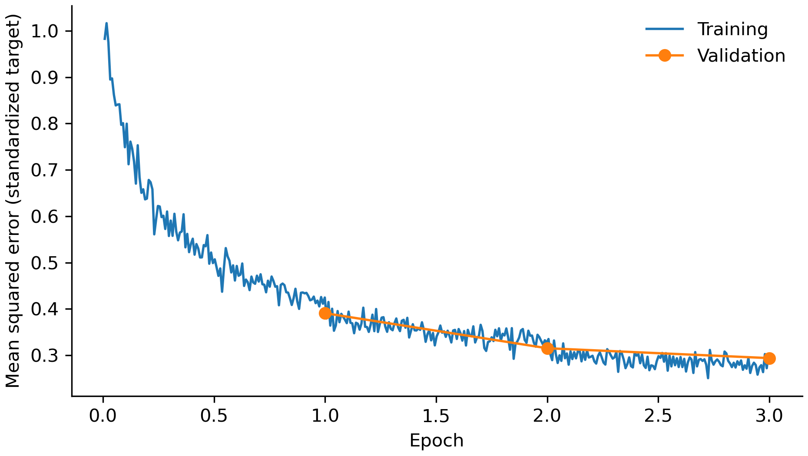

# CodonBERT for Protein-Expression Regression

Supervised fine-tuning and evaluation of pretrained CodonBERT on experimentally measured protein expression.

**[Live Demo](https://sequence-optimization-with-codonbert-b5bxoq4emkdx4hufutczmn.streamlit.app/)** · **[Hugging Face Model](https://huggingface.co/Ailin0103/CodonBERT-Cambray-expression-regression)**

## CodonBERT background

[CodonBERT](https://huggingface.co/lhallee/CodonBERT) is a pretrained codon-level transformer for representations of coding/mRNA sequences. Codon tokenization follows biologically meaningful triplets rather than arbitrary individual characters. Pretraining provides a starting representation; accurate expression prediction requires task-specific supervision and evaluation.

## What this project specializes

This project adapts pretrained CodonBERT to continuous regression using approximately 242K synthetic *E. coli* sequences from Cambray et al. Input is `gs.sequence`, target is experimentally measured protein production (`clean.lin.prot.mean`). Full supervised fine-tuning is compared against a 7-mer TF-IDF + Ridge baseline.

```text
Pretrained CodonBERT
        ↓
Cambray E. coli sequences
        ↓
Supervised fine-tuning
        ↓
Protein-expression regression
```

## Dataset

Cambray et al. Supplementary Data 15 yields 242,269 usable sequences after cleaning. The fixed split uses seed 42: 193,815 training, 24,227 validation, and 24,227 test sequences (80/10/10). Missing or nonnumeric targets and invalid/frame-misaligned sequences are excluded. DNA is converted to RNA and formatted as non-overlapping codons; sequences exceeding 62 codons raise an error.

Raw data are not redistributed. Place the original CSV at:

```text
data/Supplementary_Data_15_Integrated_Phenotypic_Measurements.csv
```

## Modeling approach

**7-mer TF-IDF + Ridge:** overlapping nucleotide 7-mers, TF-IDF features, Ridge alpha 1.0 (reported vocabulary: 16,345).

**Fine-tuned CodonBERT:** `lhallee/CodonBERT` with a scalar regression head, full-model fine-tuning, learning rate `1e-5`, three epochs, batch size 16. Targets use training-set mean and sample standard deviation. Metrics are computed after reversing standardization.

## Training behavior



Extracted from the existing final training run's `checkpoint-36342/trainer_state.json`; no retraining was required. Training loss is logged every 100 steps and validation loss once per epoch. Both are MSE on standardized targets; lines connect observations at their actual logged epochs.

Validation loss fell from 0.391 to 0.315 to 0.294 across the three epochs. Optimization progressed with smaller validation gains in the final epoch; these observations do not establish full convergence. There is no validation-loss upturn indicating obvious overfitting within this horizon. Underlying observations are in `results/training_history.csv`.

## Final regression results

Previously reported held-out test results, preserved unchanged:

| Model | RMSE ↓ | R² ↑ | Pearson ↑ | Spearman ↑ |
|---|---:|---:|---:|---:|
| 7-mer TF-IDF + Ridge | 17.87 | 0.547 | 0.740 | 0.745 |
| **Fine-tuned CodonBERT** | **14.09** | **0.719** | **0.855** | **0.856** |

CodonBERT reduced RMSE by approximately 21% relative to the baseline. Precise values are in `results/model_comparison.csv`. No new test evaluation was performed during framework preparation.

## Repository structure

```text
src/          model training, curve extraction, release preparation
results/      compact regression metrics, authentic training history, figure
release/      Hugging Face model card and inference example
archive/      historical experiments and screening script/results
exploratory/  earlier modeling experiments
validation/   historical tokenizer/model sanity checks
pipeline/     earlier data engineering utilities
models/       local checkpoints and release assets (ignored)
data/         local raw data (ignored)
```

## Installation and reproduction

Install the project environment with `pixi install`. From the repository root:

```bash
# Rebuild the loss curve from the existing local logs.
pixi run python src/plot_training_history.py --state models/cambray_codonbert_regression/checkpoint-36342/trainer_state.json

# Validate existing local release files and add the model card; no upload.
pixi run python src/prepare_model_release.py
```

Train the baseline or fine-tune CodonBERT using `src/train_kmer_baseline.py` and `src/train_codonbert_regression.py`, respectively. These scripts perform full training and held-out test evaluation.

## Hugging Face model

The existing local `models/cambray_codonbert_regression/final_model/` contains weights, regression configuration, tokenizer, and `target_scaler.json`. The [model card](release/README.md) documents training, evaluation, limitations, and an inference example reversing target standardization. Release preparation validates those assets and copies the card beside them.

No upload has been performed. Hugging Face authentication, destination repository selection, and an explicitly authorized upload remain manual. The [upstream model card](https://huggingface.co/lhallee/CodonBERT) supplies academic/non-commercial license terms that must be respected in release preparation.

## Limitations

Training and evaluation cover one synthetic *E. coli* library. External generalization across organisms, coding-sequence distributions, or experimental conditions has not been established. Predictions are exploratory estimates, not experimentally validated expression values for arbitrary sequences. A random split within this library does not demonstrate transfer to unrelated sequence families.

## Reference

Cambray G, Guimaraes JC, Arkin AP. *Evaluation of 244,000 synthetic sequences reveals design principles to optimize translation in Escherichia coli.* Nature Biotechnology, 2018.
